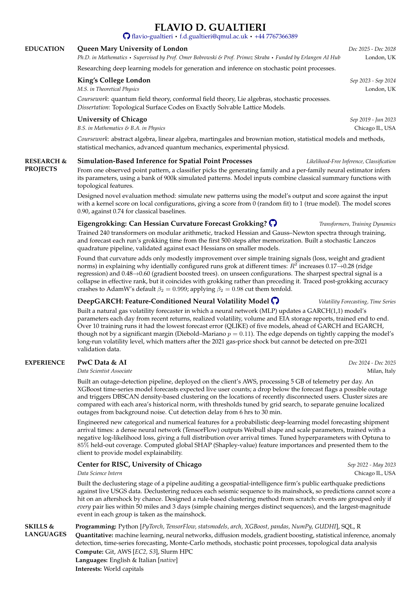

# Flavio D. Gualtieri — CV

**[View online](https://flavio-gualtieri.github.io/flavio-gualtieri-cv/)** · **[Download PDF](Flavio_Gualtieri_CV.pdf)** · [LaTeX source](Flavio_Gualtieri_CV.tex)

PhD candidate in Mathematics at Queen Mary University of London, working on deep learning for stochastic point processes. Previously a Data Scientist at PwC Data & AI.

---

The PDF is built from `Flavio_Gualtieri_CV.tex` with `latexmk -pdf`. On every push to `main`, a GitHub Action recompiles the source and publishes it to the site above.
